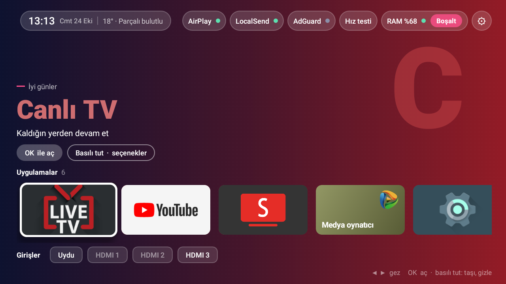

# TV Ana Ekran

Eski ve düşük donanımlı Android TV'ler için sade, hızlı bir ana ekran (launcher).
1 GB RAM'li bir **Hi-Level / Atmaca (Realtek RTD284x, Android 7.1.1)** televizyon için yazıldı;
Android 7.1+ çalışan başka Android TV cihazlarında da çalışır.



> 🇬🇧 *A lightweight home screen for old, low-memory Android TVs (Android 7.1+). Plain Java, no libraries:
> a 32 KB APK that uses ~20 MB of RAM. See the [English summary](#english) below.*

## Neden?

Bu tür televizyonlarda üreticinin ana ekranı ve hazır alternatifler 1 GB RAM'in önemli bir kısmını yiyor.
Bu ana ekran hiçbir kütüphane kullanmadan, sadece Android'in kendi bileşenleriyle yazıldı:

| | Projectivy Launcher | Üretici ana ekranı (Zeasn) | **TV Ana Ekran** |
|---|---|---|---|
| APK boyutu | ~8 MB | — | **32 KB** |
| RAM kullanımı | ~85 MB | ~48 MB + ~30 MB servis/reklam | **~20 MB** |

*(Ölçümler Hi-Level/Atmaca TV üzerinde `dumpsys meminfo` ile alındı.)*

## Özellikler

- **Uygulamalar satırı**: Android TV banner'ları; odaktaki uygulamanın rengine göre değişen arka plan ve büyük başlık
- **Girişler satırı**: Uydu ve HDMI girişlerine tek tuşla geçiş; bağlı olmayan HDMI soluk görünür
- **Üst çubuk**
  - Saat, tarih ve hava durumu ([Open-Meteo](https://open-meteo.com), anahtar gerekmez)
  - **AirPlay** durumu: [AirScreen](https://www.airscreen.app) yansıtmaya hazırsa yeşil
  - **LocalSend** durumu: [LocalSend](https://localsend.org) dosya almaya hazırsa yeşil. Telefondan TV'ye
    APK, fotoğraf ve video gönderilebilir. LocalSend kendini koruyan bir servis çalıştırmadığı için Android
    bellek sıkışınca onu kapatabiliyor; ana ekran bunu fark edip yeniden başlatır (en fazla 5 dakikada bir,
    ekranda ~1 saniye LocalSend görünür)
  - **AdGuard** durumu: ağda [AdGuard DNS](https://adguard-dns.io) çalışıyorsa yeşil
  - **Hız testi** (Cloudflare üzerinden 8 saniyelik indirme)
  - **RAM** göstergesi ve tek tuşla **Boşalt**
- **RAM'i temiz tutar**: ana ekrana dönüldüğünde ve ana ekran açık kaldıkça dakikada bir arka plandaki uygulamaları kapatır
  (AirScreen ve LocalSend hariç)
- **Arka plan servisleri**: AirScreen ve LocalSend uygulamalar satırında görünmez, üst çubuktaki düğmelerinden yönetilir
- **Kumandayla düzenleme**: OK'a basılı tut → *Taşı* (◀ ▶ ile kaydır, OK ile bırak), *En başa taşı*, *Gizle*, *Uygulama bilgisi*
- **Geri tuşu** ana ekrandan Canlı TV'ye geçer
- Sonradan yüklenen (USB, ADB vb.) uygulamalar kendiliğinden satırın sonuna eklenir
- ⚙ menüsü: selamlamada görünecek **ad**, gizli uygulamalar, TV ayarları, varsayılan düzen

## Kurulum

[Releases](../../releases) sayfasındaki APK'yı indir, sonra:

```bash
adb connect <TV-IP>:5555
adb install TvAnaEkran.apk
adb shell cmd package set-home-activity com.ozdogan.tvanaekran/.MainActivity
```

Ya da USB bellekle TV'nin dosya tarayıcısından APK'yı açıp kur; HOME tuşuna basınca ana ekranı seç.

> ⚠️ Eski ana ekranı kapatmadan önce bu ana ekranın açıldığından emin ol. Bir sorun olursa
> `adb shell cmd package set-home-activity <eski-paket>/<aktivite>` ile geri dönebilirsin.

**Selamlamaya ad eklemek:** ⚙ → *Adın*, ya da ADB ile:

```bash
adb shell "am start -n com.ozdogan.tvanaekran/.MainActivity --es isim 'Ad'"
```

## Kaynaktan derleme

Gerekenler: JDK 17, Android SDK (platform 35, build-tools 35), Gradle 8.9 (wrapper dahil).

```bash
./gradlew assembleRelease
# APK: app/build/outputs/apk/release/app-release.apk
```

Windows'ta `kur.ps1` derleyip TV'ye kurar ve ana ekran yapar:

```powershell
.\kur.ps1 -Tv 192.168.1.50:5555
```

> Release APK, kişisel kullanım için debug anahtarıyla imzalanır. Kendi anahtarınla imzalamak için
> `app/build.gradle` içindeki `signingConfig` satırını değiştir.

## TV'yi sadeleştirme betikleri (`scripts/`)

Hi-Level / Atmaca (Realtek, Hikeen yazılımı) TV'ler için ADB üzerinden çalışan PowerShell betikleri.
**Hiçbir uygulamayı silmezler**, sadece devre dışı bırakırlar; `tv-geri-al.ps1` hepsini geri açar.
Hepsi `-Tv <IP>:5555` parametresi alır.

| Betik | Ne yapar |
|---|---|
| `tv-sadelestir.ps1` | Güvenli liste: hava durumu, Adups FOTA, otel modu, ekran koruyucu, yazdırma, senkron vb. |
| `tv-sadelestir-2.ps1` | Zeasn ana ekranı, mağazası, servisleri ve reklam sağlayıcısı (yeni ana ekran kurulduktan **sonra**) |
| `tv-sadelestir-3.ps1` | Kullanılmayan analog/AV/VGA/komponent giriş servisleri ve yazılım güncelleyici |
| `tv-hiz.ps1` | Animasyonları yarıya indirir, Chrome'u kapatır |
| `tv-dns.ps1` | Kablolu bağlantıda IPv6'yı kapatır; modem IPv6 DNS'i AdGuard'ı atlıyorsa reklam engelini zorlar (root ADB gerekir; TV yeniden başlayınca ya da ağ bağlantısı tazelenince sıfırlanabilir, AdGuard noktası gri olursa tekrar çalıştır) |
| `tv-geri-al.ps1` | Devre dışı bırakılan her şeyi açar, eski ana ekranı varsayılan yapar |

> Bu TV'lerin çoğunda ağ üzerinden ADB fabrikadan **şifresiz açık** gelir (port 5555). Ağındaki
> herkes TV'ye erişebilir; işin bitince kapatmayı düşün.

## Proje yapısı

```
app/src/main/
├── AndroidManifest.xml        HOME + LEANBACK_LAUNCHER olarak tanımlama
├── java/.../MainActivity.java Ekran, odak/gezinme, taşıma modu, girişler, RAM temizliği
├── java/.../AppRepository.java Uygulama listesi, sıralama, gizleme, ayarlar
├── java/.../Status.java        Hava durumu, hız testi, AirPlay, reklam engeli, RAM
├── java/.../Colors.java        İkondan baskın renk çıkarma
└── res/layout/activity_main.xml
```

Bilinen bir Android 7 sorunu: `HorizontalScrollView` içinde sağ tuş odağı satırın sonuna atlatabiliyor.
Bu yüzden satır içi sağ/sol gezinme elle yönetiliyor (`MainActivity.onRowKey`).

## English

**TV Ana Ekran** ("TV Home Screen") is a minimal launcher for old, low-RAM Android TVs (Android 7.1+),
built for a 1 GB Hi-Level/Atmaca TV with a Realtek RTD284x chip. It is written in plain Java with no
dependencies: the APK is 32 KB and it uses about 20 MB of RAM.

It includes an app row with color-adaptive hero, Satellite/HDMI input shortcuts, a status bar (clock, weather,
AirPlay, LocalSend and ad-block status, speed test, RAM with one-tap cleanup), automatic background-app cleanup
that keeps AirScreen and LocalSend alive as background services,
remote-friendly reordering and hiding, and Back → Live TV. The UI is in Turkish.
`scripts/` contains reversible ADB debloat scripts for Hikeen/Realtek-based TVs.

## Lisans

[MIT](LICENSE)
